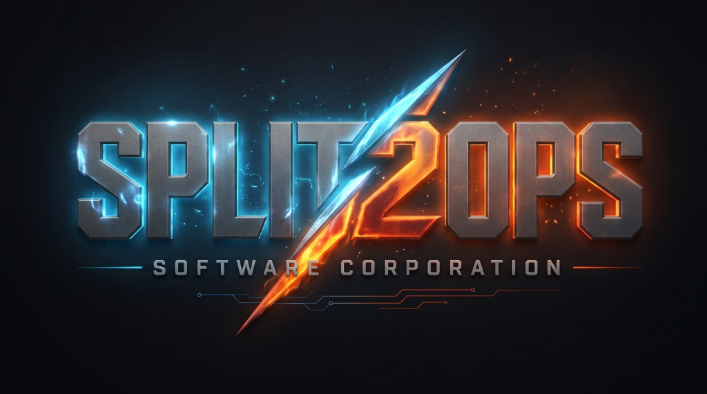

<p align="center">
  
</p>

# Split2Ops Software Corporation — Unified Release Hub

Welcome to the official public distribution repository for **Split2Ops Software Corporation** (`zv9games/s2o`).

This repository serves as the centralized distribution clearinghouse for production binaries, native installers, verified toolchains, and sovereign desktop systems engineered under the Split2Ops and Ivory Monolith Entertainment banners. The underlying micro-kernels and synthesis pipelines remain proprietary, but all public evaluation seats, desktop frameworks, and runtime templates are published here.

---

## 🏛️ Ecosystem Architecture & Flagship Platforms

Split2Ops engineers high-performance, deterministic systems across sovereign AI orchestration, generative GPU simulation, and hardware-accelerated runtimes.

```
                      ┌────────────────────────────────────────┐
                      │      SPLIT2OPS SOFTWARE CORP           │
                      │       Unified Distribution Hub         │
                      └──────────────────┬─────────────────────┘
                                         │
                 ┌───────────────────────┴───────────────────────┐
                 ▼                                               ▼
   ┌──────────────────────────┐                    ┌──────────────────────────┐
   │          TALX            │                    │       SSXL ENGINE        │
   │ Autonomous Swarm Kernel  │                    │ Generative Simulation    │
   │ & Hybrid LLM Orchestrator│                    │ & GPU-First Game Engine  │
   └──────────────────────────┘                    └──────────────────────────┘
```

---

## ⚡ 1. TALX — Sovereign Multi-Agent Desktop Kernel

**TALX** is a desktop AI micro-kernel designed for autonomous multi-bot swarm orchestration, hybrid cloud/local routing, and low-latency interaction. It runs native on Windows without container overhead, featuring cryptographic session memory and integrated local Ollama auto-detection.

### Key Capabilities in TALX Releases:
- **Autonomous Swarm Fabric:** Orchestrates specialized personas (Coordinator, Coder, Researcher, Reviewer, Creative) across coordinated task pipelines.
- **Versatile Hybrid Routing Matrix:** Granular per-bot routing policies across **Local Only (Ollama)**, **Local First**, **Cloud First**, **Cloud Only**, and **Split-Deliberation** modes.
- **Speed Chatbot Lock:** One-click instant bypass toggle to lock conversation to the low-latency **TALX Companion** for zero-jargon conversational tasks.
- **Hardware Telemetry & Ceiling Pins:** Real-time VRAM allocation meters, token latency timers, and Safe 8K KV-cache ceiling monitors.
- **DPAPI Encrypted Vault:** Hardware-bound encryption via Windows Data Protection API (DPAPI) for Groq, DeepSeek, and Gemini keys.
- **Tamper-Evident Evaluation Lifecycle:** Native Windows installer packaging with automatic previous-version detection, clean upgrades, and evaluation protection.

---

## 🎮 2. SSXL — GPU-First Generative Simulation Engine

**SSXL** is a data-oriented, GPU-accelerated game simulation platform synthesized via **SSXL-GEN**. Rather than requiring thousands of lines of manual engine boilerplate, SSXL uses an automated compiler to emit low-latency runtimes and editor tooling.

### Key Capabilities in SSXL Engine Releases:
- **Integrated Editor UI:** Complete SceneTree hierarchy, interactive Viewport canvas, and dynamic real-time Component Inspector.
- **Substrate Execution Model:** GPU-driven procedural computation, compute shader pipelines, and low-latency tick cycles.
- **Turnkey Reference Showcase:** Bundled with the official **SSXL Pacman Showcase** featuring 10 custom play modes demonstrating engine systems, input pipelines, and dynamic render passes.

---

## 🏷️ Split2Ops Distribution & Release Tiers

Software across the Split2Ops ecosystem is distributed across four distinct operational tiers:

| Tier | Status | Focus & Description |
| :--- | :---: | :--- |
| **S2O-EVAL / BETA** | **Active Now** | Public preview binaries and installers. Includes evaluation windows (such as the 21-day TALX kernel seat and SSXL showcase builds) for testing, diagnostics, and architecture audits. |
| **S2O-COMMUNITY** | *Coming Soon* | Free non-commercial and indie creation tier featuring standardized runtimes, local LLM tooling, community plugins, and runtime export capability. |
| **S2O-PRO** | *Coming Soon* | Production-grade software distributions with extended profiling toolchains, priority target export modules, and advanced compute pipelines. |
| **S2O-FOUNDER** | *Invite / Direct* | Sovereign early-adopter tier featuring direct engine architectural previews, enterprise swarm clustering, custom template modules, and bespoke synthesis hooks. |

---

## 📦 Verified Release Artifacts

Each release published to `s2o` is compiled under native release optimization (`opt-level = 3`, `lto = "fat"`, stripped symbol tables) and packaged into tamper-safe Windows installers.

### Download Directory:
- **`TALX-Setup.exe`**: Complete sovereign AI desktop kernel with native uninstaller registration and desktop shortcuts.
- **`SSXL-Setup.exe` / `SSXL-Editor.zip`**: Complete GPU simulation editor, runtime tools, and reference projects.

---

## 🛡️ Integrity & Verification

All official binaries are cryptographically mapped. Verify release checksums against the manifest published in each release tag:

```powershell
# Verify SHA256 integrity on Windows
Get-FileHash -Algorithm SHA256 .\TALX-Setup.exe
Get-FileHash -Algorithm SHA256 .\SSXL-Setup.exe
```

---

## ⚖️ License & Corporation Notice

© 2026 **Split2Ops Software Corporation** and **Ivory Monolith Entertainment LLC**. All rights reserved.

Distributed runtimes and preview builds are provided for evaluation and licensed use according to their respective EULA terms. Redistribution or reverse engineering of proprietary synthesis toolchains is strictly prohibited without written authorization from Split2Ops Software Corporation.
